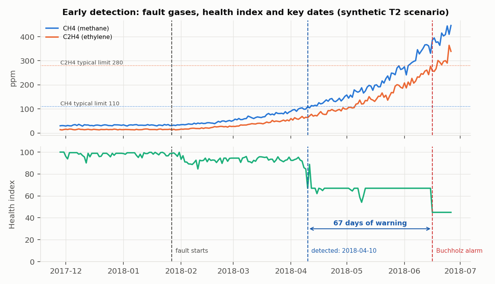

# Power Transformer (10 MVA) Health Monitoring Analytics

Working prototype that **detects early deterioration** in a 10 MVA, 33/11 kV, Dyn11, ONAN, oil-immersed power transformer with OLTC, and **tells the maintenance team what to do next**.

**Author:** Smeet Patel · October 2026

| Deliverable | Where |
|---|---|
| Code, README, requirements, Dockerfile, runnable with one command | This repository: `docker compose up --build` |
| Technical note (PDF, 4 pages): architecture, assumptions, results, limitations | [`reports/technical_note.pdf`](reports/technical_note.pdf) |
| One-page maintenance advisory (Task 5) | [`reports/maintenance_advisory.pdf`](reports/maintenance_advisory.pdf) |

## Contents

1. [Tasks implemented](#tasks-implemented)
2. [Quick start](#quick-start)
3. [Using the API](#using-the-api)
4. [Data](#data)
5. [Assumptions](#assumptions)
6. [Results](#results)
7. [Project layout](#project-layout)
8. [Tests](#tests)
9. [Limitations](#limitations)
10. [Use of AI coding assistants](#use-of-ai-coding-assistants)
11. [References](#references)

---

## Tasks implemented

| # | Task | Implementation | Code |
|---|---|---|---|
| 1 | **Thermal analytics** | 24 h top-oil forecast (XGBoost) vs 3 baselines (MAE, RMSE); hot-spot and loss of life with the IEC 60076-7 difference-equation model | `src/thermal/` |
| 2 | **DGA fault diagnosis** | Duval Triangle 1 baseline; XGBoost classifier; per-class precision/recall/F1, confusion matrix; 4 class-imbalance strategies compared | `src/dga/` |
| 3 | **Health index** | 0–100 score from thermal, DGA, oil quality and loading; 5 condition bands; top-3 drivers per score | `src/health_index/` |
| 4 | **Deployment and MLOps** | Containerised FastAPI (`/health-index`); versioned model registry; PSI and performance drift with thresholds; retraining triggers | `api/`, `src/mlops/`, `Dockerfile` |
| 5 | **Maintenance advisory** | One-page brief: health band, top risk, action with urgency, cost-benefit in INR | `src/advisory/` |
| 6 | **RAG assistant** | Answers from public O&M manuals with page citations and guardrails, using a **locally hosted** open-source LLM; includes a browser chat page | `src/rag/`, `api/static/` |

**Client clarifications applied:** synthetic data for parameters with no public source; a locally hosted LLM (no external API); costs in INR.

---

## Quick start

### Option A: Docker (one command)

Requirements: Docker Desktop. For full RAG answers, also install [Ollama](https://ollama.com) on the host with the model pulled (`ollama pull qwen2.5:3b`).

```bash
docker compose up --build
```

This builds the image, runs the full pipeline (data → models → evaluation → reports), then serves the API. When the log shows `Uvicorn running on http://0.0.0.0:8000`, open:

| URL | What it is |
|---|---|
| http://127.0.0.1:8000/docs | Interactive API documentation |
| http://127.0.0.1:8000/assistant | Chat page for the RAG assistant |
| http://127.0.0.1:8000/healthz | Status, served model versions, local-LLM availability |

Notes:
- **Timing:** the first build takes about 10–15 minutes. The pipeline then takes about 4 minutes; most of that is the local-LLM RAG evaluation.
- **Verified** with Docker Desktop 28.0.4 on Windows 11.
- **On Windows, use `127.0.0.1`, not `localhost`.** Docker Desktop's WSL relay can hold the IPv6 `localhost` (`::1`) on the published port, so `localhost` requests may hang.
- **The container uses the host's Ollama** at `host.docker.internal:11434`, so nothing extra is downloaded.
- **Machine without Ollama?** Run a fully containerised LLM instead (about 6 GB extra download):
  ```powershell
  $env:OLLAMA_URL="http://ollama:11434"; docker compose --profile ollama up --build
  ```
  If no LLM is reachable at all, the assistant still works and answers with cited extracts from the manuals.

### Option B: Local Python (3.11+)

```bash
python -m pip install -r requirements.txt
python -m src.pipeline                          # train, evaluate, write outputs/ and reports/ (~1–4 min)
python -m pytest -q tests                       # 26 tests
python -m uvicorn api.main:app --port 8000      # serve on http://127.0.0.1:8000
```

`make run`, `make test`, `make serve` and `make docker` do the same.

---

## Using the API

| Endpoint | Purpose |
|---|---|
| `POST /health-index` | Score a snapshot of readings: returns score, band, component scores, **top-3 drivers**, DGA diagnosis (ML + Duval), derived inputs, model version |
| `GET /health-index/latest` | Latest daily score of the monitored unit, from the pipeline |
| `POST /ask` | Maintenance Q&A with page citations (RAG) |
| `GET /assistant` | Browser chat page over `/ask`; citations open the manual PDF at the cited page |
| `GET /healthz` | Liveness, model versions, local-LLM status |

Example request:

```bash
curl -X POST http://127.0.0.1:8000/health-index -H "Content-Type: application/json" -d '{
  "thermal": {"top_oil_c": 78, "ageing_rate_30d": 0.6, "alarm_count_30d": 1},
  "loading": {"lv_current_a": [470, 455, 480], "hours_over_1pu_30d": 4},
  "dga": {"H2": 180, "CH4": 410, "C2H2": 2.5, "C2H4": 330, "C2H6": 150, "CO": 520, "CO2": 6200, "tdcg_rate_ppm_per_day": 15},
  "oil": {"moisture_ppm": 26, "bdv_kv": 41},
  "events": {"buchholz_alarm": false}}'
```

Response:
- `health_index` 67.0, band "Fair"
- Top drivers: active T2 fault (overall cap), T2 severity cap, CH4 410 ppm
- DGA: ML T2 (p = 0.99), Duval T2
- Derived inputs: load 0.914 pu (from currents); hot-spot 108 °C (OTI + IEC gradient)

Any field left out is skipped, and the weights are re-normalised.

---

## Data

| Data | Source | Used for |
|---|---|---|
| `Dataset/ETTm1.csv` | ETT dataset ([zhouhaoyi/ETDataset](https://github.com/zhouhaoyi/ETDataset)): 69,680 rows, 15-min, 2016-07 to 2018-06; 6 load columns + **`OT` (oil temperature, target)** | 24 h forecast; load profile for the thermal model |
| `Dataset/dga_589.xlsx` | 589 labelled DGA cases from literature ([alan-456/transformer-fault-dataset](https://github.com/alan-456/transformer-fault-dataset); E. Li, IEEE DataPort 2019). 5 gases + fault type (Chinese labels → PD/D1/D2/T1/T2/T3) | DGA classifier training |
| `Dataset/data(Sheet1).csv` | IEC TC 10 database: 113 faults confirmed by inspection, 7 gases + fault code (Duval & dePablo, IEEE EI Magazine 2001; via [fedebenelli/DGANN](https://github.com/fedebenelli/DGANN)) | Unseen DGA test set |
| `Dataset/fist3_30.pdf`, `Dataset/...transformer-diagnostics...pdf` | US Bureau of Reclamation FIST 3-30 *Transformer Maintenance* (2000) and FIST 3-31 *Transformer Diagnostics* (2003), public domain | RAG corpus (494 chunks) |
| Synthetic (`src/data/synthetic.py`, seed 42) | Ambient temperature, 3-phase V/I, OLTC tap, daily DGA of the monitored unit, quarterly moisture/BDV, Buchholz/PRD/OTI/WTI events | Parameters with no public source (approved by the client) |

**Data preparation and quality findings:**
- **Leakage removed:** 109 of the 113 IEC TC 10 cases also appear in the 589-case file. These rows (112, including copies) and 4 exact duplicates were removed from training, leaving **473 cases**. The IEC TC 10 test is therefore truly unseen.
- **ETT units are not published:** `|HUFL|` is scaled so its 99.5th percentile = 1.0 pu.
- **ETT has no weather columns:** load correlates only 0.05–0.22 with OT.
- **ETT OT shifts year-on-year:** June mean 18.1 °C in 2017 vs 9.5 °C in 2018.

**Synthetic data verification** (`tests/test_synthetic.py`, 9 tests):
- **Reproducibility:** same seed gives identical output.
- **Ambient:** matches WMO normals within ±1.5 °C, with a realistic seasonal and daily shape.
- **Currents:** current = K × rating; LV/HV ratio = 3; imbalance < 5 %.
- **OLTC:** holds LV within ±5 %.
- **Thermal:** top-oil > ambient; hot-spot ≥ top-oil.
- **Events:** every event at or above its threshold.
- **DGA:** healthy before the fault; Duval = T2 at the end; CO2/CO within 3–10.
- **Oil:** moisture rises as BDV falls, ending in the IEC 60422 "fair" band.

---

## Assumptions

**Every assumption is in [`config.yaml`](config.yaml), with its source.** Change a value there and re-run the pipeline. Key values:

| Area | Assumption |
|---|---|
| Transformer | 10 MVA, 33/11 kV, Dyn11, ONAN, 175/525 A; OLTC 17 taps × 1.25 % |
| Thermal (IEC 60076-7 ONAN typical) | x = 0.8, y = 1.3, R = 6, H = 1.3, gr = 26 K, top-oil rise 52 K, τo = 210 min, τw = 10 min; non-upgraded paper (98 °C), normal life 180,000 h |
| Alarms | OTI 85/95 °C, WTI 100/110 °C (alarm/trip) |
| Site climate | Ahmedabad, WMO monthly normals [R1] |
| DGA "normal" limits | IEC 60599 typical values [R2]: H2 150, CH4 110, C2H4 280, C2H6 90, CO 900, CO2 13,000 ppm; C2H2 3 ppm [R4] |
| Oil limits (IEC 60422 cat. C) | Water 30/40 ppm [R6]; BDV 40/30 kV |
| Health index | Weights DGA 0.35, thermal 0.25, oil 0.20, loading 0.20; bands Very Good ≥ 85, Good ≥ 70, Fair ≥ 50, Poor ≥ 30, Very Poor < 30 |
| Costs (INR) | Repair ₹60 lakh; outage ₹40,000/h; 720 h failure outage; action ₹3.5 lakh + 24 h outage; 12-month PoF by band 0.5/1/4/12/30 %; action effectiveness 70 % |
| Forecast | Day-ahead load forecast simulated as actual future load + 5 % error |

---

## Results

All numbers come from `outputs/summary.json` (local Windows run). In Docker (Linux), XGBoost's multi-threaded training gives marginally different values (e.g. causal MAE 1.722 vs 1.716); no conclusion changes.

### Task 1: Thermal

**Forecast** (test period 2018-01 to 2018-06, 16,880 points; chronological split with a 24 h gap):

| Model | MAE (°C) | RMSE (°C) |
|---|---|---|
| Persistence (= 24 h seasonal naive) | 1.718 | 2.237 |
| Seasonal naive 7 d | 2.997 | 3.849 |
| Trailing 24 h mean | 1.932 | 2.482 |
| XGBoost, causal (past data only) | 1.716 | 2.165 |
| **XGBoost + day-ahead load forecast** | **1.597** | **2.047** |

- **Without weather inputs, persistence is hard to beat.** The causal model ties it on MAE and is 3 % better on RMSE.
- **With a day-ahead load forecast,** MAE improves by 7 %.
- **Features are level-free** (relative to the current OT). An absolute-level version scored 3.1 °C because of the year-on-year shift.

**IEC 60076-7:**
- Max top-oil 94 °C; max hot-spot 137 °C.
- Loss of life 3,215 h over 2 years, i.e. **1.79 % of normal life**.
- The hot-spot gradient is clamped at ≥ 0. Without it, the standard equations place the hot-spot below top-oil after sharp load drops, which is not physical.

### Task 2: DGA

**5-fold stratified cross-validation, 473 cases:**

| Method | Macro-F1 | Accuracy |
|---|---|---|
| Duval Triangle 1 (baseline) | 0.550 | 0.560 |
| XGBoost, no imbalance handling | 0.830 | 0.837 |
| **XGBoost, class-balanced weights (selected)** | **0.843** | **0.850** |
| XGBoost + SMOTE (inside training folds only) | 0.843 | 0.850 |
| Random forest, balanced | 0.833 | 0.839 |

**Per class:**

| Class | Precision | Recall | F1 |
|---|---|---|---|
| PD | 0.88 | 0.77 | 0.82 |
| D1 | 0.76 | 0.77 | 0.76 |
| D2 | 0.81 | 0.88 | 0.84 |
| T1 | 0.86 | 0.89 | 0.88 |
| T2 | 0.83 | 0.80 | 0.82 |
| T3 | 0.95 | 0.93 | 0.94 |

The confusion matrix is in `outputs/fig_dga_confusion.png`.

**Class imbalance:**
- Largest/smallest class ratio is 1.9.
- Class weights w_c = n / (k · n_c), from 0.74 for T1 to 1.41 for T2.
- Selected on **macro-F1**, so rare classes count equally.
- Weights were preferred over SMOTE: the scores tie, and weights create no synthetic gas samples and carry no leakage risk.

**Unseen IEC TC 10 test** (113 cases, T1+T2 merged): Duval macro-F1 **0.86** vs ML 0.72.
- Duval's zones were derived from these very cases, so it wins there.
- ML is far better on the broader literature data.
- Both diagnoses are reported; disagreement flags expert review.

### Task 3: Health index and early detection

**How the score is built:**
- Each parameter is scored 100 → 0 between a good and a bad limit.
- Components are weighted averages of their parameters; HI = weighted sum of components.
- **Drivers:** HI = 100 − Σ points lost, so the top-3 drivers are exactly the parameters that lost the most points.

**Caps:**

| Condition | Cap |
|---|---|
| DGA component, by fault severity | 100 × (1 − 0.7 × severity) |
| Overall index, active diagnosed fault | 100 − 55 × severity (T2 → 67, at best "Fair") |
| Buchholz alarm | 45 |
| Buchholz trip / PRD | 20 |

**Latest (2018-06-26):** **45.0, "Poor"**. Drivers: Buchholz alarm cap, moisture 34.6 ppm, CH4 446 ppm.

**Early detection** (synthetic T2 fault starting 2018-01-27):
- DGA flagged abnormal on **2018-04-10**; ML and Duval both diagnosed **T2**.
- Band went to Fair the same day.
- That is **67 days before the Buchholz alarm** (2018-06-16).
- **0 DGA false alarms** in the 575 healthy days before the fault.



### Task 4: MLOps

- **Versioning:**
  - Each model lives in `models/<name>/<semver>/` as `model.joblib` + `metadata.json` (config SHA-256, data fingerprints, metrics, features).
  - A `LATEST` pointer selects the served model; rollback = edit one file.
  - API responses carry `model_version`.
- **Data drift:**
  - PSI per key input, last 30 days vs the same 30 days one year earlier. Threshold 0.2.
  - Result: OT PSI 8.07 (mean 18.2 → 9.6 °C) → retraining triggered.
- **Performance drift:**
  - Rolling 7-day forecast MAE / validation MAE. Threshold 1.5.
  - Max in 2018: 2.17.
- **DGA monitoring:** ML-vs-Duval disagreement rate on new samples. API requests are logged for drift checks.
- **Retraining triggers:**
  - PSI breach
  - MAE ratio > 1.5 for 3 days
  - ≥ 25 new inspection-confirmed DGA cases
  - every 90 days

  A new model is promoted only if it beats the served model on the latest hold-out window.

### Task 5: Maintenance advisory

`reports/maintenance_advisory.pdf`:

| Item | Value |
|---|---|
| Band | Poor |
| Urgency | **HIGH: within 2 weeks** |
| Top risk | Thermal fault 300–700 °C (ML T2, Duval T2) |
| Action | Lab DGA confirmation; IR thermography; winding-resistance and core-insulation tests; load cap 0.8 pu; Buchholz gas sample |
| Cost-benefit | Expected loss ₹41.8 lakh without action vs ₹13.6 lakh action cost → **net benefit ₹15.7 lakh (B/C 2.2)** |

### Task 6: RAG assistant

- **Retrieval:** TF-IDF over 494 chunks of FIST 3-30/3-31.
- **Answering:** **Qwen2.5-3B-Instruct served locally by Ollama** (temperature 0, no external API). Answers only from the retrieved text, with `[n]` page citations.
- **Fallback:** cited extracts when no LLM is reachable.

**Guardrails:**
1. Refuse when the question is outside the transformer domain or the retrieval similarity is < 0.08.
2. Refuse when the model replies `INSUFFICIENT_CONTEXT`.
3. Sentence-level grounding: each sentence must cite a source, with ≥ 60 % of its content words and all of its numbers present in that source.
4. A safety notice on every answer.

**Evaluation:** 9/9 correct answer-or-refuse decisions (6 answered with citations, 3 off-topic refused).

---

## Project layout

```
config.yaml              all assumptions and settings (with sources)
Dataset/                 public input data
src/
  data/                  ETT loader (per-unit load), synthetic generators
  thermal/               IEC 60076-7 model, 24 h forecast
  dga/                   data preparation, Duval Triangle 1, ML classifier
  health_index/          scoring, caps, drivers; daily timeline
  mlops/                 model registry, drift metrics, retraining triggers
  advisory/              one-page advisory + cost model
  rag/                   retrieval, local LLM, guardrails
  reporting/             figures, technical note
  pipeline.py            end-to-end run (python -m src.pipeline)
api/
  main.py                FastAPI service
  static/assistant.html  chat page
tests/                   26 automated tests
outputs/                 generated: metrics (summary.json), figures, CSVs
models/                  generated: versioned models + metadata
reports/                 generated: technical note, maintenance advisory
Dockerfile, docker-compose.yml, requirements.txt, Makefile
```

`outputs/`, `models/` and `reports/` are included so results can be inspected without running anything. Every run of the pipeline regenerates them.

---

## Tests

`python -m pytest -q tests` runs **26 tests**.

**`tests/test_core.py` (17):**
- Duval zones and the Normal screen
- IEC 60076-7 reference points and the ageing law
- Scoring and band boundaries; an active fault can never be "Good"; drivers and caps
- The RAG grounding check
- API endpoints, the chat page and RAG refusal

**`tests/test_synthetic.py` (9):** synthetic-data plausibility against published sources.

---

## Limitations

- **ETT is a different transformer.** It has an unknown rating and no weather data. The monitored unit's DGA, oil tests, events and costs are synthetic or assumed, so the 67-day lead time demonstrates the mechanism, not real-world performance.
- **IEC 60076-7 constants are typical values,** not factory heat-run data. WTI is calculated, not measured.
- **DGA training data is compiled from literature** with mixed labelling. There is no Normal or DT training class, and CO/CO2 are not used by the classifier.
- **Health-index weights, limits and failure probabilities are expert assumptions.** They need calibration against utility failure and inspection records.
- **The forecast ties persistence without weather inputs.**
- **RAG runs a small CPU model** (8–40 s per answer). The grounding check is lexical, so semantic errors are possible, e.g. a misread table row in a garbled PDF, or a false premise accepted from the question. A larger local model (`qwen2.5:7b`) is a one-line change in `config.yaml`.
- **Some IEC table values** (60076-7 constants, 60599 Annex B zone coordinates, 60422 BDV limits) are paywalled and could not be re-checked against a public source.

---

## Use of AI coding assistants

**How Claude Code (Anthropic) was used:**
- writing and refactoring code
- tests and figures
- the report generators
- documentation

**What the author did:**
- chose the approach and design decisions
- inspected the datasets, finding the IEC TC 10 overlap and the corrupted CSV export
- checked assumptions against published sources
- reviewed all results

The author can explain and modify any part of the implementation.

---

## References

Verification status:
- ✅ value checked in the source
- ⚠️ secondary source
- ❌ paywalled / not verified

| Key | Source | Used for | Status |
|---|---|---|---|
| R1 | WMO climate normals, Ahmadabad (station 42647), [JMA Tokyo Climate Center](https://ds.data.jma.go.jp/gmd/tcc/tcc/products/climate/normal/parts/NrmMonth_e.php?stn=42647) | Ambient temperature | ✅ |
| R2 | M. Duval, A. dePablo, "Interpretation of gas-in-oil analysis using new IEC publication 60599 and IEC TC 10 databases", *IEEE Electrical Insulation Magazine* 17(2), 2001 | IEC 60599 typical gas values; IEC TC 10 test data | ✅ |
| R3 | USBR FIST 3-30 *Transformer Maintenance* (2000): CO2/CO limits (p.59), Doble oil limits (Table 12) | Synthetic DGA/oil checks; RAG corpus | ✅ |
| R4 | USBR FIST 3-31 *Transformer Diagnostics* (2003): TDCG rates (Table 2), C2H2 guidance (p.7), Duval Triangle | TDCG-rate score; C2H2 limit | ✅ |
| R5 | J. Kunicki et al., *Energies* 12(18):3561, 2019, [doi:10.3390/en12183561](https://doi.org/10.3390/en12183561) | Thermal exponents x, y, H | ⚠️ |
| R6 | IEC 60422:2013 category C water limits, via [Practice of IEC 60422 in ageing assessment of in-service transformers](https://www.researchgate.net/publication/318109817_Practice_of_IEC_60422_in_ageing_assessment_of_in-service_transformers) | Oil moisture score | ⚠️ |
| R7 | Vaisala white paper B211282EN, [moisture vs breakdown voltage](https://www.vaisala.com/sites/default/files/documents/CEN-TIA-power-whitepaper-Moisture-and-Breakdown-Voltage-B211282EN-A-LOW.pdf) | Moisture–BDV relation | ✅ |
| R8 | A. Jahromi et al., "An approach to power transformer asset management using health index", *IEEE EI Magazine*, 2009 | Health-index gas weights | ❌ |
| R9 | Indian utility alarm-setting practice examples | OTI/WTI thresholds (assumption) | ⚠️ |
| — | H. Zhou et al., "Informer", AAAI 2021 (ETDataset); E. Li, DGA dataset, IEEE DataPort 2019 | Datasets | ✅ |
| — | IEC 60076-7:2018, IEC 60599, IEC 60422:2013 | Thermal model, Duval zones, oil limits | ❌ paywalled |

**Assumptions without a source** (engineering judgement):
- OLTC configuration
- 3 % phase imbalance
- shape and timing of the synthetic fault
- cost figures and failure probabilities
- the hot-spot clamp
